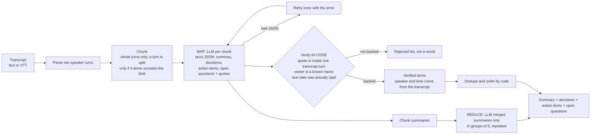

# Meeting Summarizer (map-reduce, quotes checked in code)

Give it a meeting transcript (plain text or WebVTT, with speaker names and optional timestamps). It returns a summary,
decisions, action items (owner, task, due date if stated) and open questions. Long transcripts are split into chunks,
each chunk is summarised, and the results are merged. **Every decision, action item and open question must quote the
transcript line it came from, and the code checks that quote; items the transcript does not back are dropped, never shown as results.**

## Data: what is public and what is synthetic
- **Synthetic (in this repo):** `eval/transcripts/` holds five short, hand-written invented meetings (one is WebVTT) and
  `eval/gold.json` lists the decisions, action items and open questions each one contains. One transcript (t4) has no
  decisions or action items on purpose. The tests use small invented transcripts too. Nothing in the evaluation or the tests is real.
- **Public demo transcript (not in this repo):** the US Federal Open Market Committee conference call of 4 October 2019,
  <https://www.federalreserve.gov/monetarypolicy/files/FOMC20191004confcall.pdf>, converted to text by
  `scripts/download_transcript.py` into `data/demo/` (git-ignored). **It is only an optional demo; it is not used by the tests or the evaluation.**
  - **Credit:** Federal Reserve Board, FOMC conference call transcript, October 4, 2019.
  - **Licence note:** the Board's [disclaimer](https://www.federalreserve.gov/disclaimer.htm) says information on its website is in the public domain and may be copied and distributed without permission, and asks users to cite the Board as the source. It excludes material from non-Board sources; check the notice yourself before reuse.
  - **Size:** the PDF is 75 pages (about 146,000 characters of text, 162 speaker turns): **36 chunks at the default size, which is over the default `MAX_CHUNKS=30` limit, so the full text is refused unless you raise the limit** (and it would take 40+ LLM calls). `--max-turns 40` keeps the first 40 turns, which is 10 chunks.

## Architecture


## Tech
Python 3.11, OpenAI SDK (any OpenAI-compatible endpoint, or Azure OpenAI), pypdf (only for the optional demo download), pytest, Docker.

## How to run
```powershell
python -m venv .venv
.venv\Scripts\pip install -r requirements.txt
copy .env.example .env                              # fill in your own values; .env is git-ignored
```
Load your environment variables, then:
```powershell
$env:PYTHONPATH = "src"
python -m meeting_summarizer eval\transcripts\t1_sprint_planning.txt
python -m meeting_summarizer eval\transcripts\t2_product_sync.vtt --json
python scripts\download_transcript.py --max-turns 40   # optional public demo, then:
python -m meeting_summarizer data\demo\fomc_2019-10-04.txt
```
Input formats: `Name: text`, `[00:01:02] Name: text`, `(01:02) Name: text`, `00:01:02 Name: text`; WebVTT with `<v Name>` voice tags or
`Name:` prefixes. The format is detected automatically (`--format text|vtt` forces one).

| Purpose | Variables |
|---|---|
| OpenAI-compatible endpoint | `OPENAI_API_KEY`, `OPENAI_BASE_URL`, `OPENAI_MODEL` |
| Azure OpenAI, key mode | `AZURE_OPENAI_ENDPOINT`, `AZURE_OPENAI_API_KEY`, `AZURE_OPENAI_DEPLOYMENT`, `AZURE_OPENAI_API_VERSION` |
| Azure OpenAI, sign-in mode (key not set) | the same endpoint/deployment/version, plus `AZURE_TENANT_ID`, `AZURE_CLIENT_ID`, `AZURE_CLIENT_SECRET` |
| Optional limits | `CHUNK_CHARS` (6000), `MAX_CHUNKS` (30), `MAX_TRANSCRIPT_CHARS` (400000), `LLM_TIMEOUT_SECONDS` (60) |

If Azure variables are set, Azure is used; otherwise the OpenAI-compatible variables. A missing variable gives a clear message,
not a crash. The client waits and retries on HTTP 429 (up to 6 times, using the wait time in the error, else 15 s).
The command exits with 0 for `ok` and `partial` results and 1 for `failed`, `empty_transcript` and `too_long`.

### Tests (no key, no downloads)
```powershell
python -m pytest -q
```
Tests use a fake LLM and small invented transcripts.

### Evaluation
```powershell
python -m meeting_summarizer.evaluate --mock          # plumbing check: scripted fake LLM
python -m meeting_summarizer.evaluate --live --delay 13 --out docs\eval_live.json
```
`--mock` prints "NOT accuracy"; its numbers must not be quoted as results (the scripted model is given the gold answers, plus invented
items on t4 to show that the code rejects them). `--live` uses the real LLM on the five synthetic transcripts. A gold item counts as
found when the output has an item containing all of its keywords (action items also need the gold owner and, if the gold has one, the due
date). Items not in the gold list are reported as "extra", not as wrong. The report also counts how many items the model proposed that the
code rejected, how many kept items had an owner or due date cleared, and whether the no-items transcript produced zero decisions and action items.
`--delay SECONDS` pauses between transcripts for free-tier limits; t5 is run with 1,500-character chunks so that it needs several chunks and a merge step.

## Design choices
- **Anti-invention is code, not a prompt** (`src/meeting_summarizer/verify.py`):
  - the quote must appear (ignoring case, punctuation and spacing) inside **one** speaker turn and have at least 4 words, otherwise the item is rejected and listed under "dropped";
  - the item's speaker and time come from the transcript turn that holds the quote, not from the model;
  - an owner must be a speaker (full name or a part of it) or a name that appears in the transcript; generic owners ("we", "the team", "TBD") mean unassigned; an unknown owner is cleared and flagged, and the item is kept because its quote is real;
  - a due date is kept exactly as the model wrote it only if that text appears in the transcript; otherwise it is cleared and flagged. Dates are not converted ("Friday" stays "Friday").
- **The merge step cannot add items.** Only the chunk summaries (prose) go to the merging LLM call, in groups of 6 and repeated until one summary is left; decisions, action items and questions are merged by code from the verified items, de-duplicated and ordered by position in the transcript.
- **Chunks follow speaker turns.** Whole turns are packed up to the chunk size; a turn is split (at sentence ends, then spaces) only if it alone is larger than a chunk. Quotes are still checked against the original, unsplit turn.
- **Strict JSON with one retry** (the error is fed back). A chunk that still fails is reported and the rest is used (`partial`); two LLM errors in a row stop the run to avoid long waits.
- **Nothing is written to the transcript.** Empty, unreadable or over-limit input never reaches the LLM.
- **Speech-to-text is not included** (see Next steps); the project only claims what it shows.

## Results
Live LLM results on the five synthetic transcripts (`eval/gold.json`: 7 decisions, 12 action items, 4 open questions, plus one transcript with none):

| Measure | Result |
|---|---|
| Decisions found / in gold (7) | not yet measured |
| Action items found (right owner, task and due date) / in gold (12) | not yet measured |
| Open questions found / in gold (4) | not yet measured |
| Extra items not in the gold list (decisions / action items) | not yet measured |
| No-items transcript: zero decisions and action items returned | not yet measured |
| Items the model proposed that the code rejected | not yet measured |

## Limitations
- **A real quote can be attached to a wrong claim.** The checks prove the quote exists in the transcript; they cannot prove it supports the task, owner or decision written next to it. Each item shows its quote so a reader can check.
- **The summary text is not verified.** Only decisions, action items and questions are checked; the prose summary comes from the model.
- **Prompt injection is possible.** Transcript text that tells the model what to do can influence the summary; the quote check limits invented items but cannot stop a model from being steered towards real lines.
- **Plain-text speaker detection is a heuristic.** Any line shaped like `Some Words: text` (up to 4 words) starts a new speaker, so a line such as `Action item: send the notes` inside a turn would be read as a speaker named "Action item".
- **Due dates are not interpreted:** "by Friday" is kept as written and is not turned into a calendar date; a model-computed date such as 2024-06-07 is cleared because the transcript does not contain it.
- **Privacy:** the transcript text is sent to your LLM provider.
- English transcripts only; no speaker identification from audio.
- The evaluation set is five short invented meetings written by the author; keyword matching is a rough test; results will apply to that set only.
- The public demo transcript is long (36 chunks in full) and has not been run through the tool.
- The Docker image has not been built or verified yet.

## Next steps
- **Speech-to-text:** an optional audio input using a small local model (for example faster-whisper `tiny.en`). Whisper gives timestamps but no speaker names, so audio input would produce transcripts without speakers; not implemented, and nothing in this repo claims it.
- Run the live evaluation and fill in the results table; use the per-transcript details to explain each miss.
- Optional date interpretation (turn "next Wednesday" into a date given the meeting date) as a separate, clearly labelled step.
- Build and verify the Docker image.
